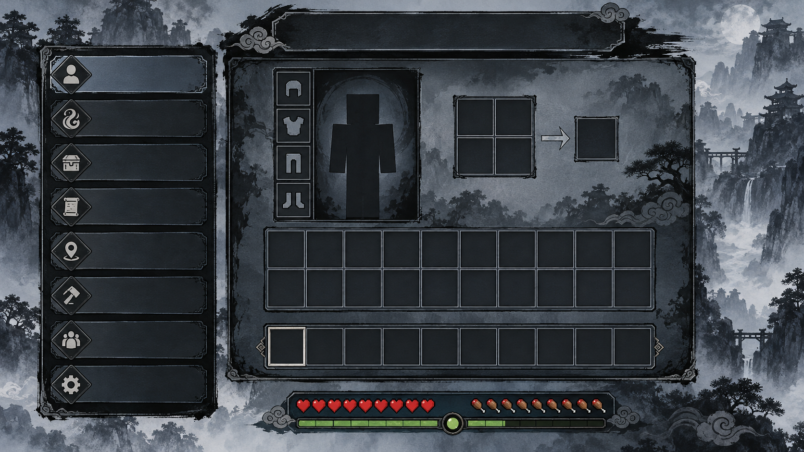
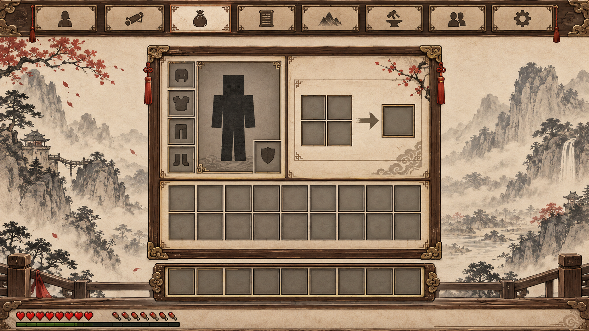
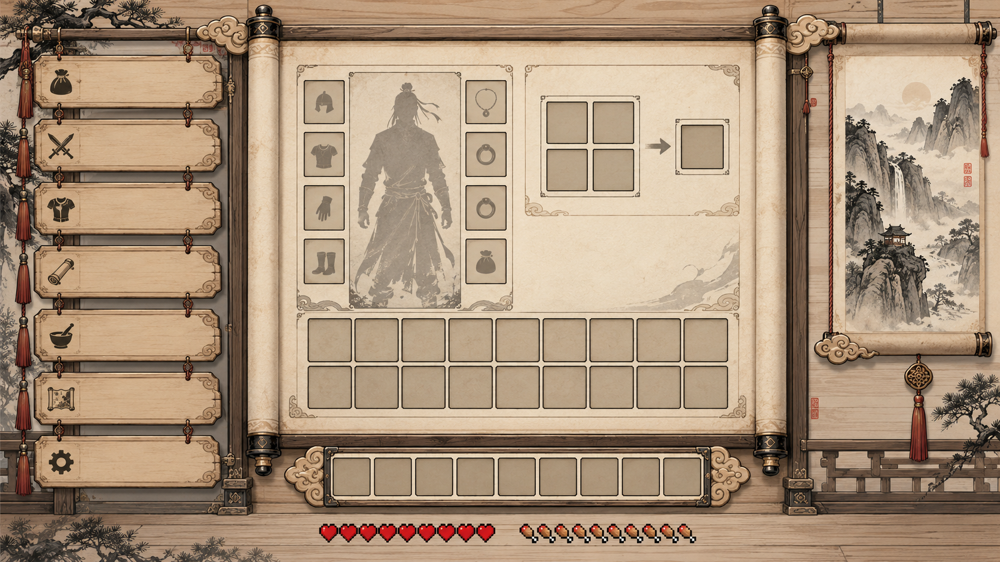
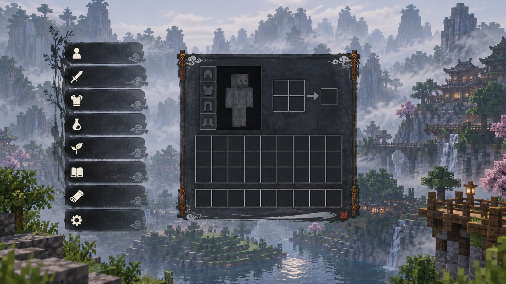

# 강호이문록 화면 목록·프레임 시안 (2026-10-24)

상태: **선택용 콘셉트 4종**. 게임 화면, 서버 메뉴, 설정, 애니메이션은 아직 바꾸지 않았다. 사용자가 제공한 여덟 장의 참고 이미지에서 먹선·먹구름·목재·화선지·운문 장식이라는 시각 요소를 읽어 새 화면 배치를 제안했다. 참고 이미지의 글자, 텍스처, 아이콘을 복사한 구현물은 아니다. 시안의 글자 자리는 실제 구현 시 한글 UI 폰트로 넣기 위해 비워 두었다.

| 선택 | 이미지 | 화면 목록 위치 | 프레임 성격 | 적합한 용도 |
| --- | --- | --- | --- | --- |
| A 먹빛 석판 | `A_ink_slate.png` | 왼쪽 세로 | 짙은 청회색 석판과 절제된 붓선 | 임무·경지 등 정보가 많은 화면 |
| B 화선지·목재 | `B_hanji_wood.png` | 상단 가로 탭 | 따뜻한 화선지와 호두색 목재, 붉은 낙관 | 소지품·제작처럼 오래 보는 화면 |
| C 두루마리 현판 | `C_scroll_board.png` | 왼쪽 목재 현판 | 밝은 펼친 두루마리와 양쪽 축 | 세계관을 강하게 드러내는 메인 메뉴 |
| D 먹안개 오버레이 | `D_ink_overlay.png` | 왼쪽 짧은 세로 목록 | 반투명 먹빛 패널, 적은 장식 | 게임 월드를 보며 여는 빠른 메뉴 |

### A · 먹빛 석판

### B · 화선지·목재

### C · 두루마리 현판

### D · 먹안개 오버레이

## 화면 목록 초안

현재 서버 메뉴 구현에는 **운명 결정, 강호록(인물·문파·경지·내공·보유 무공 정보), 문파, 문파 무공** 화면이 있다. 문파 임무는 문파 화면의 정보 항목이며 독립 화면이 아니다. 따라서 첫 적용 목록은 `강호록 · 문파 · 무공`의 실제 화면과 `경지 · 내공 · 임무`의 정보 항목을 구분해 잡는다. 참고 이미지에 보이는 `소지품/제작`은 바닐라 인벤토리와 연결할 별도 후보이며, `지도/관계/설정`은 향후 기능 또는 기존 화면으로 가는 탭이다. 선택 전에는 미구현 화면을 작동하는 메뉴로 표시하지 않는다.

어느 시안을 선택하든 구현 단계에서는 실제 메뉴 기능과 슬롯 개수를 먼저 고정한다. 이 그림의 빈 칸은 분위기와 배치 검토용으로, Minecraft의 정확한 인벤토리 슬롯 수를 보증하지 않는다. 최종 화면은 서버의 9×3 메뉴 슬롯과 바닐라 소지품 9×3·핫바 9칸, 장비·제작 슬롯을 각각 검증하고, 아이템 이동·클릭·키보드 단축키를 유지해야 한다. 16:9 이미지만 기준으로 고정하지 않고 Minecraft GUI 배율과 다른 화면비에 맞춘다.

## 재제작용 프롬프트 세트

모두 내장 imagegen 도구로 새 `ui-mockup` 이미지를 생성했다. 공통 프롬프트는 “Minecraft Java 무협 RPG의 실제 사용 가능한 정면 UI 화면, 메뉴 목록과 인벤토리 프레임 및 하단 HUD를 16:9로 배치, 글자 자리는 비워 두고 의미 없는 생성 문자를 넣지 않음, 3D 제품 렌더나 기존 게임 화면 복제 금지”였다.

- A: 먹빛 청회색 석판, 왼쪽 세로 8행 목록, 흑색 붓선·안개 산·작은 구름 장식, 오른쪽 큰 인벤토리 프레임.
- B: 크림색 화선지, 호두색 목재 테두리, 위쪽 8개 현판 탭, 붉은 낙관, 넓은 인벤토리 프레임.
- C: 밝은 목재 기둥과 펼친 두루마리, 왼쪽 세로 현판 목록, 먼 산 수묵화 창, 가운데 큰 프레임.
- D: 게임 세계를 비추는 반투명 청흑색 먹빛 패널, 왼쪽 짧은 목록, 작은 중앙 프레임, 장식 최소화.

선택 후에는 이 PNG를 게임에 통째로 붙이지 않는다. 선택한 시안의 색·프레임·운문을 픽셀 단위 UI 자산으로 다시 제작하고, 실제 한글 문구와 슬롯 좌표를 코드/리소스에서 정확히 배치한다.
